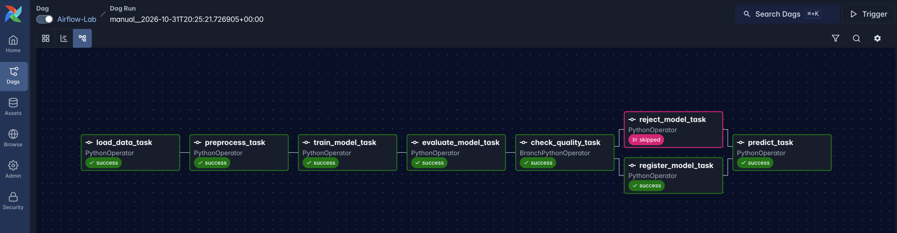
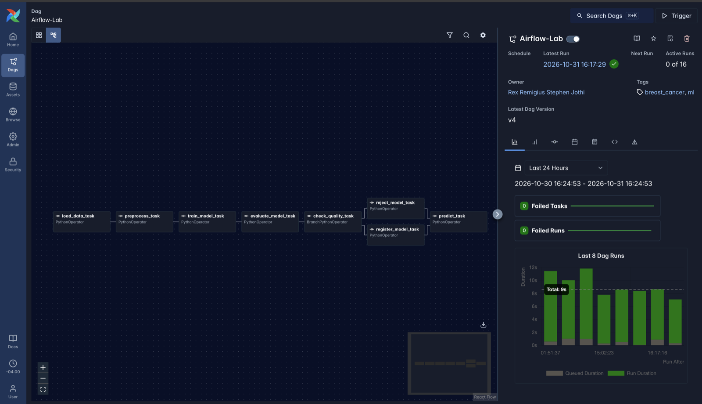
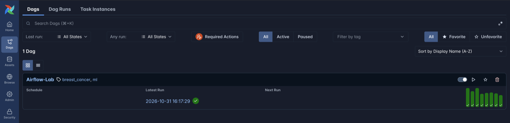
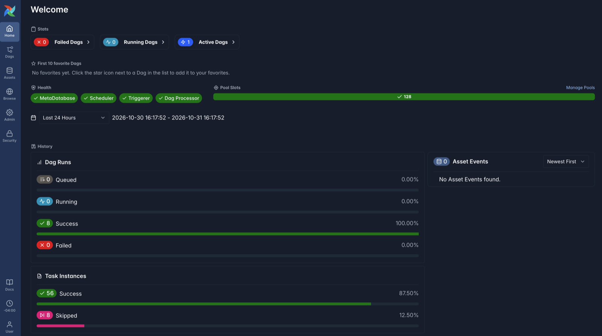

# Airflow Lab 1 : Breast Cancer Classifier

This is my modified version of Airflow Lab 1. This version trains a breast cancer classifier, keeps the model simple, and uses it to show more of Airflow.

The modified lab lives in [`airflow_lab/`](airflow_lab/). The original lab's code in [`dags/`](dags/) is not modified.



## What changed

| | Original lab | Modified lab |
|---|---|---|
| Airflow | 2.5.1 | 3.3.2 (Python 3.13, scikit-learn 1.9) |
| Dataset | Credit card customers (`file.csv`, 8,950 rows) | Wisconsin Diagnostic Breast Cancer (563 tumors, 30 features) |
| Problem | Unsupervised clustering | Supervised binary classification: malignant vs benign |
| Model | KMeans, with the number of clusters picked by the elbow method | RandomForestClassifier |
| Passing data between tasks | Whole DataFrames pickled and base64-encoded into XCom | Files in a per-run folder. XCom only carries small values like the metrics |
| Model output | `dags/model/model.sav`, overwritten on every run | `working_data/runs/<run_id>/model.joblib` for every run, plus a registry of accepted models |
| Quality check | None, every model is used | The model is registered only if its test F1 clears a threshold |
| Configuration | Hard-coded | Chosen in the Trigger form: `n_estimators`, `max_depth`, `min_f1` |
| Schedule | Daily (Airflow 2's default, since no schedule was set) | Daily at midnight UTC, set explicitly with `@daily`. Manual triggers still work |

## Pipeline

`load_data → preprocess → train_model → evaluate_model → check_quality → register_model | reject_model → predict`

| Task | What it does |
|---|---|
| `load_data_task` | Checks that `breast_cancer.csv` has a `diagnosis` column with two classes, then copies it into the run folder as `raw.csv` |
| `preprocess_task` | Drops missing and duplicate rows, encodes malignant as 1, and writes a stratified 80/20 split (`train.csv`, `test.csv`) |
| `train_model_task` | Fits a RandomForest with the `n_estimators` and `max_depth` params (scheduled runs use the defaults) and saves `model.joblib` |
| `evaluate_model_task` | Scores the model on the 20% split and returns accuracy, precision, recall, F1, and ROC-AUC, which Airflow pushes to XCom |
| `check_quality_task` | Gets the metrics from XCom. Picks `register_model_task` if F1 ≥ `min_f1`, otherwise `reject_model_task` |
| `register_model_task` | Copies the model and its metrics into `working_data/registry/` and points `latest.json` at it |
| `reject_model_task` | Logs why the model was rejected and which model the registry still serves |
| `predict_task` | Loads the registered model, classifies the 6 unlabeled tumors in `data/test.csv`, and writes `predictions.csv` |



### Airflow features used

- **Scheduling:** `schedule='@daily'` runs the pipeline every day at midnight UTC with the default params. With `catchup=False`, Airflow doesn't backfill past days. When the DAG is turned on, it runs only the most recent missed day, then continues daily. Airflow has to be running at midnight UTC for a run to happen; if it was down, the latest missed run starts when it comes back. Because `breast_cancer.csv` doesn't change, each daily run retrains the same model. In a real pipeline, new data would arrive between runs.
- **Params:** `n_estimators`, `max_depth`, and `min_f1` appear as a form when you click **Trigger**. Airflow validates them, so for example `min_f1` must be between 0 and 1.
- **Templating:** each task gets `{{ run_id }}` and `{{ params.* }}` through `op_kwargs`. `render_template_as_native_obj=True` makes `{{ params.n_estimators }}` arrive as the int `100` instead of the string `"100"`.
- **XCom:** `evaluate_model_task` returns the metrics dict, and `check_quality_task` receives it through `evaluate_model_task.output`. Datasets and models never go through XCom. They're files in the run folder.
- **Branching:** `BranchPythonOperator` returns the `task_id` to run next, and Airflow marks the other branch as skipped (pink in the graph).
- **Trigger rules:** one branch is always skipped, so with the default rule (`all_success`) `predict_task` would be skipped too. It uses `none_failed_min_one_success` so it runs after whichever branch ran.
- **DAG docs and tags:** the module docstring is shown on the DAG's page (`doc_md`), and the DAG is tagged `breast_cancer` and `ml`.

## Dataset

- **`dags/data/breast_cancer.csv`:** the [Wisconsin Diagnostic Breast Cancer](https://archive.ics.uci.edu/dataset/17/breast+cancer+wisconsin+diagnostic) dataset, exported from scikit-learn. It has 563 tumors (354 benign, 209 malignant). Each row has 30 measurements of the cell nuclei in a biopsy image (the mean, standard error, and worst value of radius, texture, perimeter, area, smoothness, compactness, concavity, concave points, symmetry, and fractal dimension) and a `diagnosis` label.
- **`dags/data/test.csv`:** 6 more tumors (3 malignant, 3 benign) with no `diagnosis` column. They were held out of `breast_cancer.csv`, so the model never trains on them. `predict_task` classifies them.

There are two files called `test.csv`. `dags/data/test.csv` is new, unlabeled data for predictions. The labeled 20% split used for scoring is written to `working_data/runs/<run_id>/test.csv` on each run.

## Results

With the default parameters (100 trees, max depth 5), every run gives the same numbers, because both the split and the model use `random_state=42`.

| Metric | Value |
|---|---|
| Accuracy | 0.938 |
| Precision | 0.927 |
| Recall | 0.905 |
| F1 | 0.916 |
| ROC-AUC | 0.985 |

F1 0.916 is at least 0.90, so the model is registered. Triggering with `n_estimators = 1` and `max_depth = 1` gives F1 0.875, which takes the reject branch.

Predictions for the 6 held-out tumors:

| Sample | Prediction | Malignant probability | Actual |
|---|---|---|---|
| 1 | benign | 0.001 | benign |
| 2 | benign | 0.001 | benign |
| 3 | malignant | 0.998 | malignant |
| 4 | malignant | 0.946 | malignant |
| 5 | benign | 0.427 | **malignant (missed)** |
| 6 | benign | 0.030 | benign |

### Notes

- **Why `min_f1` defaults to 0.90:** the test split has only 113 tumors (42 malignant), so one or two mistakes move F1 by 2 to 3 points. Every reasonable forest scored 0.916 on this split, and a single depth-1 tree scored 0.875, so 0.90 separates a working model from a broken one.
- **Recall matters most here:** a missed cancer, like sample 5, is worse than a false alarm. Changing the check in `choose_branch` to `metrics['recall']` would make the gate focus on missed cancers.
- **Data leakage:** before the 6 tumors were held out, a model trained on the full dataset classified all 6 correctly, because it had probably seen them in training. The honest result, from a model that never saw them, is 5 out of 6.

## Project structure

```
Lab_1/
├── airflow_lab/                                 revamped lab (run Docker from here)
│   ├── docker-compose.yaml                      not in git, download it (see How to run)
│   └── dags/
│       ├── airflow.py                           DAG definition
│       ├── src/breast_cancer_classification.py  ML functions (plain Python, no Airflow imports)
│       └── data/
│           ├── breast_cancer.csv                labeled data for training and scoring
│           └── test.csv                         6 unlabeled tumors for predict_task
├── assets/                                      screenshots for this README
├── dags/                                        original KMeans lab (unchanged)
└── README.md
```

## How to run

You need Docker Desktop. `docker-compose.yaml` isn't in the repo, so start by downloading the official one for Airflow 3.3.2. If the folder already has a `docker-compose.yaml`, this overwrites it.

```bash
cd Labs/Airflow_Labs/Lab_1/airflow_lab
curl -LfO 'https://airflow.apache.org/docs/apache-airflow/3.3.2/docker-compose.yaml'
echo "AIRFLOW_UID=$(id -u)" > .env   
```

Then make these changes in `docker-compose.yaml`:

1. **Mount the output folder (required).** Under `x-airflow-common` → `volumes:`, add the last line shown below. Without it, the pipeline's outputs stay inside the containers and never appear in `airflow_lab/working_data/`.
   ```yaml
   volumes:
     - ${AIRFLOW_PROJ_DIR:-.}/dags:/opt/airflow/dags
     - ${AIRFLOW_PROJ_DIR:-.}/logs:/opt/airflow/logs
     - ${AIRFLOW_PROJ_DIR:-.}/config:/opt/airflow/config
     - ${AIRFLOW_PROJ_DIR:-.}/plugins:/opt/airflow/plugins
     - ${AIRFLOW_PROJ_DIR:-.}/working_data:/opt/airflow/working_data
   ```
2. **Hide Airflow's example DAGs .** Change `AIRFLOW__CORE__LOAD_EXAMPLES: 'true'` to `'false'`.
3. **Change the UI port (optional).** The official file serves the UI on port 8080. I use 8085: under `airflow-apiserver` → `ports:`, change `"8080:8080"` to `"8085:8080"`. If port 8080 is free on your machine, you can keep it and open http://localhost:8080 instead.

Set `_PIP_ADDITIONAL_REQUIREMENTS = kneed`

Now start Airflow:

```bash
docker compose up -d                  # the first start also runs airflow-init
```

1. Open http://localhost:8085 (Since port 8080 already used in my machine) and log in with `airflow` / `airflow`.
2. On the **Dags** page, turn on the toggle for `Airflow-Lab`. This starts the daily schedule, and Airflow immediately runs the most recent missed day with the default params, so a model gets registered. `predict_task` needs a registered model, and fails if the registry is empty.
3. To run it again without waiting for midnight UTC, click **Trigger**.
4. To see the reject branch, trigger again with `n_estimators = 1` and `max_depth = 1`.
5. Click a task, then **Logs** to see its output, or **XCom** to see what it returned.

To stop everything, run `docker compose down`. Add `-v` to also delete the Airflow database.





## Where files are saved

The code runs inside Docker containers, so the paths in the code are container paths. `docker-compose.yaml` mounts folders from `airflow_lab/` into the containers, so the same files show up on your machine:

| On your machine (`airflow_lab/...`) | Inside the containers | Contents |
|---|---|---|
| `dags/` | `/opt/airflow/dags` | The DAG file, `src/`, and `data/` |
| `working_data/` | `/opt/airflow/working_data` | Pipeline outputs |
| `logs/` | `/opt/airflow/logs` | Task logs |
| `config/` | `/opt/airflow/config` | `airflow.cfg` |

You only need to provide `docker-compose.yaml` and `dags/`. On the first `docker compose up`, the `airflow-init` service and Docker create `logs/`, `config/`, `plugins/`, and `working_data/`, and the code creates the run and registry folders.

After a run, `working_data/` contains:

```
working_data/
├── runs/<run_id>/
│   ├── raw.csv            snapshot of breast_cancer.csv for this run
│   ├── train.csv          80% split, used for training
│   ├── test.csv           20% split, used for scoring
│   ├── model.joblib       this run's model (saved even if it's rejected)
│   ├── metrics.json       test metrics
│   └── predictions.csv    predictions for dags/data/test.csv
└── registry/
    ├── <run_id>/          model.joblib and metrics.json, for accepted models only
    └── latest.json        the model predict_task uses
```
<br>

---


# Airflow lab

- In order to install Airflow using docker you can watch our [Airflow Lab1 Tutorial Video](https://youtu.be/exFSeGUbn4Q?feature=shared)
- For latest step-by-step instructions, check out this blog - [AirFlow Lab-1](https://www.mlwithramin.com/blog/airflow-lab1)

### ML Model

This script is designed for data clustering using K-Means clustering and determining the optimal number of clusters using the elbow method. It provides functionality to load data from a CSV file, perform data preprocessing, build and save a K-Means clustering model, and determine the number of clusters based on the elbow method.

#### Prerequisites

Before using this script, make sure you have the following libraries installed:

- pandas
- scikit-learn (sklearn)
- kneed
- pickle

#### Usage

You can use this script to perform K-Means clustering on your dataset as follows:

```python
# Load the data
data = load_data()

# Preprocess the data
preprocessed_data = data_preprocessing(data)

# Build and save the clustering model
sse_values = build_save_model(preprocessed_data, 'clustering_model.pkl')

# Load the saved model and determine the number of clusters
result = load_model_elbow('clustering_model.pkl', sse_values)
print(result)
```

#### Functions

1. **load_data():**
   - *Description:* Loads data from a CSV file, serializes it, and returns the serialized data.
   - *Usage:*
     ```python
     data = load_data()
     ```

2. **data_preprocessing(data)**
   - *Description:* Deserializes data, performs data preprocessing, and returns serialized clustered data.
   - *Usage:*
     ```python
     preprocessed_data = data_preprocessing(data)
     ```

3. **build_save_model(data, filename)**
   - *Description:* Builds a K-Means clustering model, saves it to a file, and returns SSE values.
   - *Usage:*
     ```python
     sse_values = build_save_model(preprocessed_data, 'clustering_model.pkl')
     ```

4. **load_model_elbow(filename, sse)**
   - *Description:* Loads a saved K-Means clustering model and determines the number of clusters using the elbow method.
   - *Usage:*
     ```python
     result = load_model_elbow('clustering_model.pkl', sse_values)
     ```
### Airflow Setup

Use Airflow to author workflows as directed acyclic graphs (DAGs) of tasks. The Airflow scheduler executes your tasks on an array of workers while following the specified dependencies.

References

-   Product - https://airflow.apache.org/
-   Documentation - https://airflow.apache.org/docs/
-   Github - https://github.com/apache/airflow

#### Installation

Prerequisites: You should allocate at least 4GB memory for the Docker Engine (ideally 8GB).

Local

-   Docker Desktop Running

Cloud

-   Linux VM
-   SSH Connection
-   Installed Docker Engine - [Install using the convenience script](https://docs.docker.com/engine/install/ubuntu/#install-using-the-convenience-script)

#### Tutorial

1. Create a new directory

    ```bash
    mkdir -p ~/app
    cd ~/app
    ```

2. Running Airflow in Docker - [Refer](https://airflow.apache.org/docs/apache-airflow/stable/howto/docker-compose/index.html#running-airflow-in-docker)

    a. You can check if you have enough memory by running this command

    ```bash
    docker run --rm "debian:bullseye-slim" bash -c 'numfmt --to iec $(echo $(($(getconf _PHYS_PAGES) * $(getconf PAGE_SIZE))))'
    ```

    b. Fetch [docker-compose.yaml](https://airflow.apache.org/docs/apache-airflow/2.5.1/docker-compose.yaml)

    ```bash
    curl -LfO 'https://airflow.apache.org/docs/apache-airflow/2.5.1/docker-compose.yaml'
    ```

    c. Setting the right Airflow user

    ```bash
    mkdir -p ./dags ./logs ./plugins ./working_data
    echo -e "AIRFLOW_UID=$(id -u)" > .env
    ```

    d. Update the following in docker-compose.yml

    ```bash
    # Donot load examples
    AIRFLOW__CORE__LOAD_EXAMPLES: 'false'

    # Additional python package
    _PIP_ADDITIONAL_REQUIREMENTS: ${_PIP_ADDITIONAL_REQUIREMENTS:- pandas }

    # Output dir
    - ${AIRFLOW_PROJ_DIR:-.}/working_data:/opt/airflow/working_data

    # Change default admin credentials
    _AIRFLOW_WWW_USER_USERNAME: ${_AIRFLOW_WWW_USER_USERNAME:-airflow2}
    _AIRFLOW_WWW_USER_PASSWORD: ${_AIRFLOW_WWW_USER_PASSWORD:-airflow2}
    ```

    e. Initialize the database

    ```bash
    docker compose up airflow-init
    ```

    f. Running Airflow

    ```bash
    docker compose up
    ```

    Wait until terminal outputs

    `app-airflow-webserver-1  | 127.0.0.1 - - [17/Feb/2023:09:34:29 +0000] "GET /health HTTP/1.1" 200 141 "-" "curl/7.74.0"`

    g. Enable port forwarding

    h. Visit `localhost:8080` login with credentials set on step `2.d`

3. Explore UI and add user `Security > List Users`

4. Create a python script [`dags/sandbox.py`](dags/sandbox.py)

    - BashOperator
    - PythonOperator
    - Task Dependencies
    - Params
    - Crontab schedules

    You can have n number of scripts inside dags dir

5. Stop docker containers

    ```bash
    docker compose down
    ```
### Airflow DAG Script

This Markdown file provides a detailed explanation of the Python script that defines an Airflow Directed Acyclic Graph (DAG) for a data processing and modeling workflow.

#### Script Overview

The script defines an Airflow DAG named `your_python_dag` that consists of several tasks. Each task represents a specific operation in a data processing and modeling workflow. The script imports necessary libraries, sets default arguments for the DAG, creates PythonOperators for each task, defines task dependencies, and provides command-line interaction with the DAG.

#### Importing Libraries

```python
# Import necessary libraries and modules
from airflow import DAG
from airflow.operators.python_operator import PythonOperator
from datetime import datetime, timedelta
from src.lab import load_data, data_preprocessing, build_save_model, load_model_elbow
from airflow import configuration as conf
```
The script starts by importing the required libraries and modules. Notable imports include the `DAG` and `PythonOperator` classes from the `airflow` package, datetime manipulation functions, and custom functions from the `src.lab` module.


#### Enable pickle support for XCom, allowing data to be passed between tasks
```python
conf.set('core', 'enable_xcom_pickling', 'True')
```

#### Define default arguments for your DAG
```python
default_args = {
    'owner': 'your_name',
    'start_date': datetime(2023, 9, 17),
    'retries': 0,  # Number of retries in case of task failure
    'retry_delay': timedelta(minutes=5),  # Delay before retries
}
```
Default arguments for the DAG are specified in a dictionary named default_args. These arguments include the DAG owner's name, the start date, the number of retries, and the retry delay in case of task failure.

#### Create a DAG instance named 'your_python_dag' with the defined default arguments
``` python 
dag = DAG(
    'your_python_dag',
    default_args=default_args,
    description='Your Python DAG Description',
    schedule_interval=None,  # Set the schedule interval or use None for manual triggering
    catchup=False,
)
```
Here, the DAG object dag is created with the name 'your_python_dag' and the specified default arguments. The description provides a brief description of the DAG, and schedule_interval defines the execution schedule (in this case, it's set to None for manual triggering). catchup is set to False to prevent backfilling of missed runs.


#### Task to load data, calls the 'load_data' Python function
``` python 
load_data_task = PythonOperator(
    task_id='load_data_task',
    python_callable=load_data,
    dag=dag,
)
```

#### Task to perform data preprocessing, depends on 'load_data_task'
```python 
data_preprocessing_task = PythonOperator(
    task_id='data_preprocessing_task',
    python_callable=data_preprocessing,
    op_args=[load_data_task.output],
    dag=dag,
)
```
The 'data_preprocessing_task' depends on the 'load_data_task' and calls the data_preprocessing function, which is provided with the output of the 'load_data_task'.

#### Task to build and save a model, depends on 'data_preprocessing_task'
```python
build_save_model_task = PythonOperator(
    task_id='build_save_model_task',
    python_callable=build_save_model,
    op_args=[data_preprocessing_task.output, "model.sav"],
    provide_context=True,
    dag=dag,
)
```
The 'build_save_model_task' depends on the 'data_preprocessing_task' and calls the build_save_model function. It also provides additional context information and arguments.

#### Task to load a model using the 'load_model_elbow' function, depends on 'build_save_model_task'
``` python
load_model_task = PythonOperator(
    task_id='load_model_task',
    python_callable=load_model_elbow,
    op_args=["model.sav", build_save_model_task.output],
    dag=dag,
)
```
The 'load_model_task' depends on the 'build_save_model_task' and calls the load_model_elbow function with specific arguments.

#### Set task dependencies
```python
load_data_task >> data_preprocessing_task >> build_save_model_task >> load_model_task
```
Task dependencies are defined using the >> operator. In this case, the tasks are executed in sequence: 'load_data_task' -> 'data_preprocessing_task' -> 'build_save_model_task' -> 'load_model_task'.

#### If this script is run directly, allow command-line interaction with the DAG
```python
if __name__ == "__main__":
    dag.cli()
```
- Lastly, the script allows for command-line interaction with the DAG. When the script is run directly, the dag.cli() function is called, providing the ability to trigger and manage the DAG from the command line.
- This script defines a comprehensive Airflow DAG for a data processing and modeling workflow, with clear task dependencies and default arguments.

### Running an Apache Airflow DAG Pipeline in Docker

This guide provides detailed steps to set up and run an Apache Airflow Directed Acyclic Graph (DAG) pipeline within a Docker container using Docker Compose. The pipeline is named "your_python_dag."

#### Prerequisites

- Docker: Make sure Docker is installed and running on your system.

#### Step 1: Directory Structure

Ensure your project has the following directory structure:

```plaintext
your_airflow_project/
├── dags/
│   ├── airflow.py     # Your DAG script
├── src/
│   ├── lab.py                # Data processing and modeling functions
├── data/                       # Directory for data (if needed)
├── docker-compose.yaml         # Docker Compose configuration
```

#### Step 2: Docker Compose Configuration
Create a docker-compose.yaml file in the project root directory. This file defines the services and configurations for running Airflow in a Docker container.

#### Step 3: Start the Docker containers by running the following command

```plaintext
docker compose up
```

Wait until you see the log message indicating that the Airflow webserver is running:

```plaintext
app-airflow-webserver-1 | 127.0.0.1 - - [17/Feb/2023:09:34:29 +0000] "GET /health HTTP/1.1" 200 141 "-" "curl/7.74.0"
```

#### Step 4: Access Airflow Web Interface
- Open a web browser and navigate to http://localhost:8080.

- Log in with the credentials set in the .env file or use the default credentials (username: admin, password: admin).

- Once logged in, you'll be on the Airflow web interface.

#### Step 5: Trigger the DAG
- In the Airflow web interface, navigate to the "DAGs" page.

- You should see the "your_python_dag" listed.

- To manually trigger the DAG, click on the "Trigger DAG" button or enable the DAG by toggling the switch to the "On" position.

- Monitor the progress of the DAG in the Airflow web interface. You can view logs, task status, and task execution details.

#### Step 6: Pipeline Outputs

- Once the DAG completes its execution, check any output or artifacts produced by your functions and tasks. 